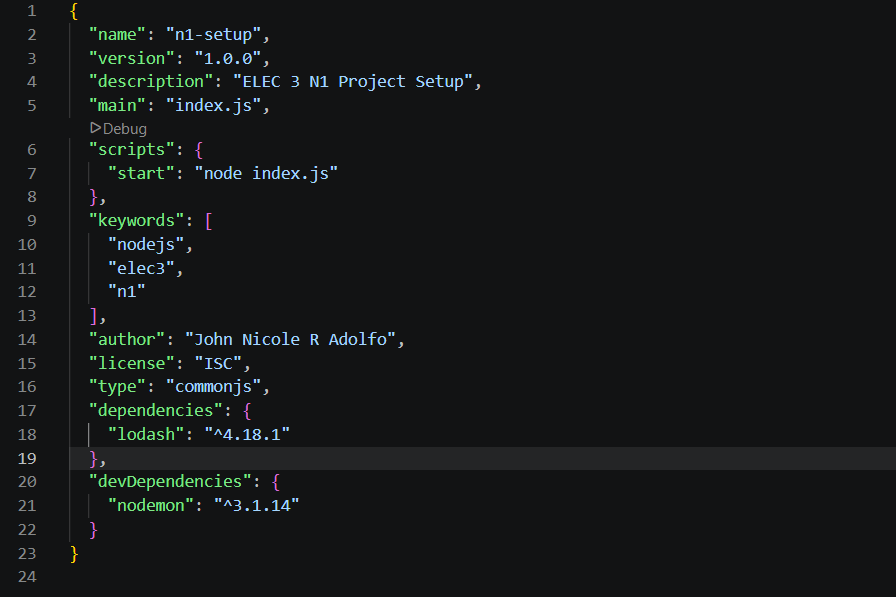
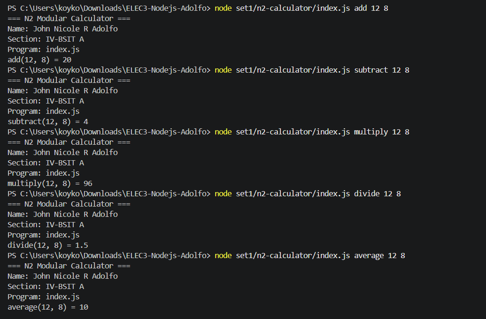
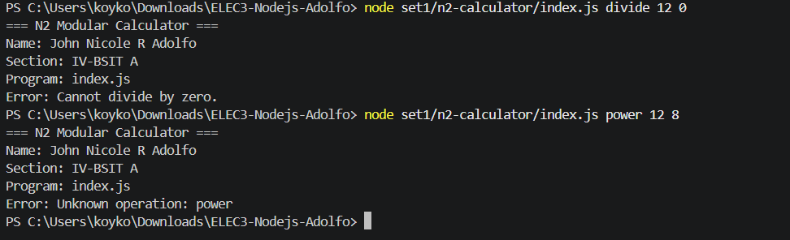
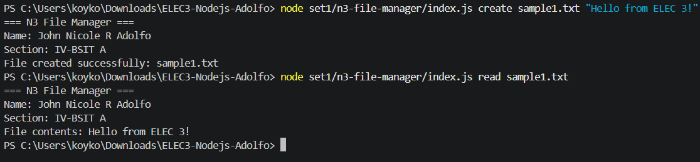
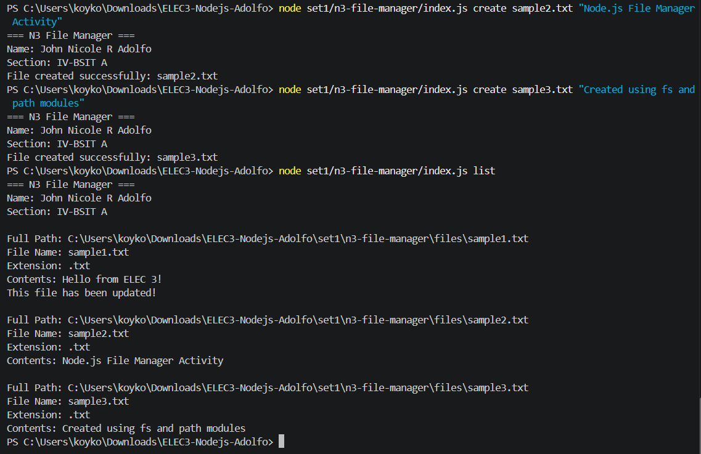

# ELEC 3 - Node.js

**Name:** John Nicole R Adolfo  
**Section:** IV-BSIT A  
**Course:** ELEC 3 - Node.js

## Set 1 Activities

### N1 - Project Setup and Package Management

A Node.js project that demonstrates npm initialization, package.json configuration, and installation of dependencies and development dependencies.

**Activity Folder:** [N1](set1/n1-setup/)

**How to Run:**

```bash
cd set1/n1-setup
npm install
npm start
```

**Sample Outputs:**





### N2 - Modular Calculator

A command-line calculator using custom modules and the built-in path module. It supports addition, subtraction, multiplication, division, and average, with error handling.

**Activity Folder:** [N2](set1/n2-calculator/)

**How to Run:**

```bash
node set1/n2-calculator/index.js add 12 8
```

**Sample Outputs:**





### N3 - File Manager with fs and path

A command-line file manager that uses the built-in fs and path modules to create, read, update, delete, and list text files.

**Activity Folder:** [N3](set1/n3-file-manager/)

**How to Run:**

```bash
node set1/n3-file-manager/index.js list
```

**Sample Outputs:**





