# ELEC 3 - Node.js

**Name:** John Nicole R Adolfo  
**Section:** IV-BSIT A  
**Course:** ELEC 3 - Node.js

## Set 1 Activities

### N1 - Project Setup and Package Management

A Node.js project that demonstrates npm initialization, package.json configuration, and installation of dependencies and development dependencies.

**Activity Folder:** [N1](set1/n1-setup/)

**How to Run:**

```bash
cd set1/n1-setup
npm install
npm start
```

**Sample Outputs:**

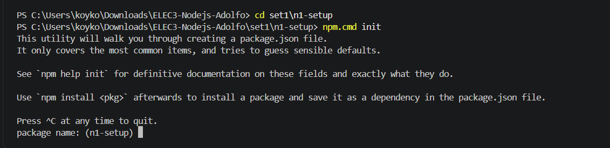


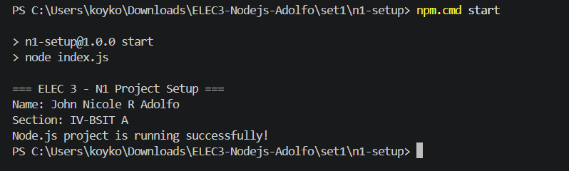

### N2 - Modular Calculator

A command-line calculator using custom modules and the built-in path module. It supports addition, subtraction, multiplication, division, and average, with error handling.

**Activity Folder:** [N2](set1/n2-calculator/)

**How to Run:**

```bash
node set1/n2-calculator/index.js add 12 8
```

**Sample Outputs:**


### N3 - File Manager with fs and path

A command-line file manager that uses the built-in fs and path modules to create, read, update, delete, and list text files.

**Activity Folder:** [N3](set1/n3-file-manager/)

**How to Run:**

```bash
node set1/n3-file-manager/index.js list
```

**Sample Outputs:**


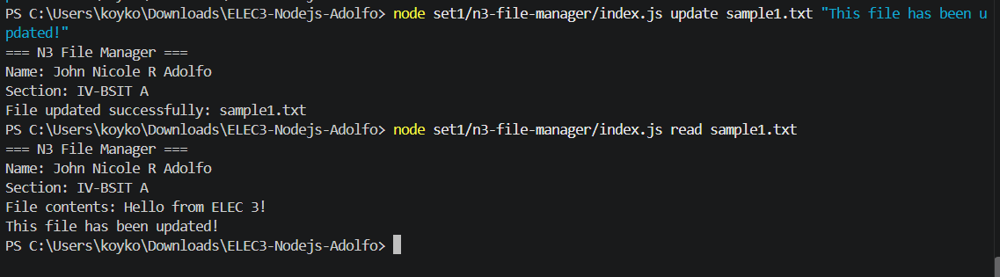

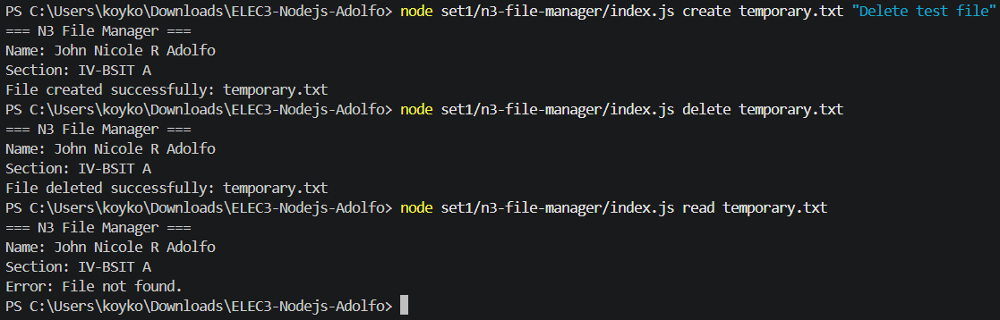


---

## Set 2 – Node.js Activities

### N4 – Basic HTTP Server

A Node.js HTTP server with Home, About, Contact, and 404 pages.

**Folder:** [N4](set2/n4-server/)

**Run:**
`node set2/n4-server/server.js`

**Screenshots:**

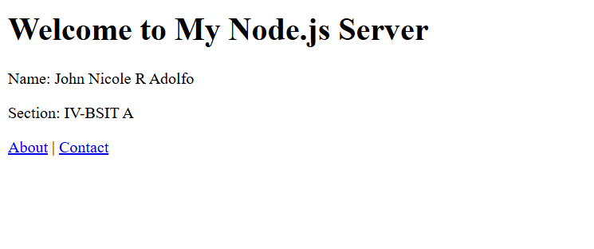

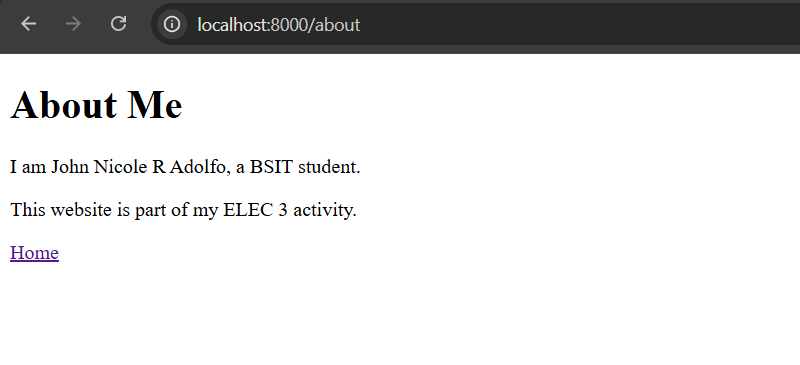

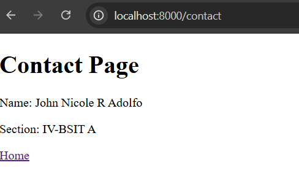

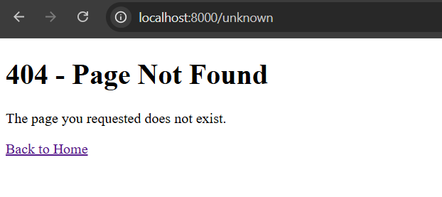

### N5 – Books REST API

A REST API that supports GET, POST, PUT, and DELETE requests for managing books.

**Folder:** [N5](set2/n5-api/)

**Run:**
`node set2/n5-api/server.js`

**Endpoints:**
- GET /api/books
- GET /api/books/:id
- POST /api/books
- PUT /api/books/:id
- DELETE /api/books/:id

### N6 – Middleware and API Testing

A Books REST API with request logging and automatic JSON response headers.

**Folder:** [N6](set2/n6-middleware/)

**Run:**
`node set2/n6-middleware/server.js`

**Screenshots:**

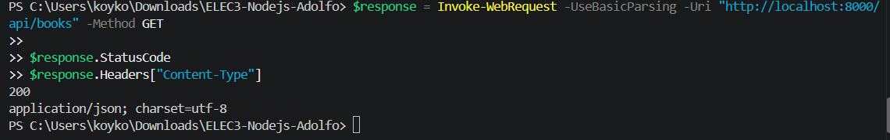

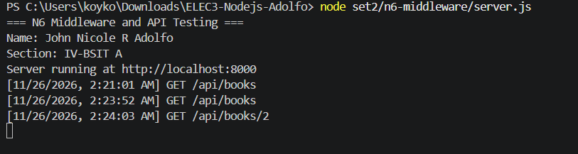

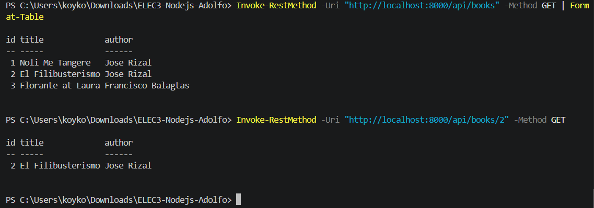

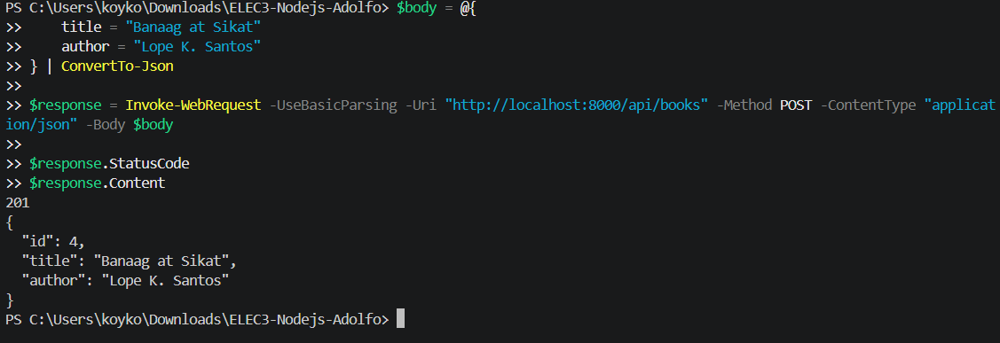

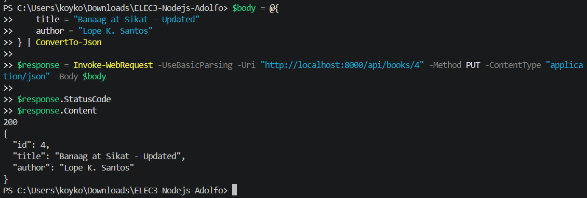

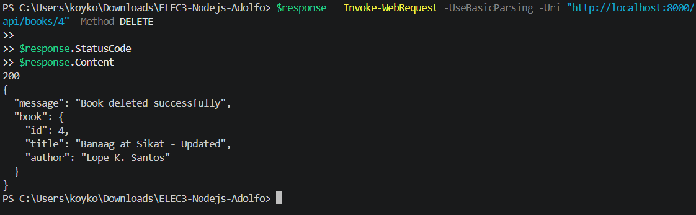

**Written Answers:** [N6_answers.docx](set2/n6-middleware/N6_answers.docx)
